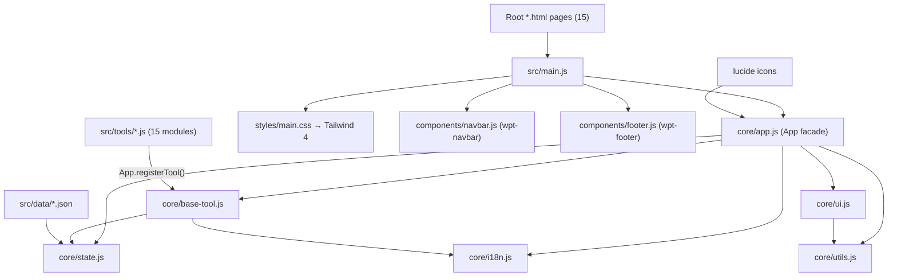
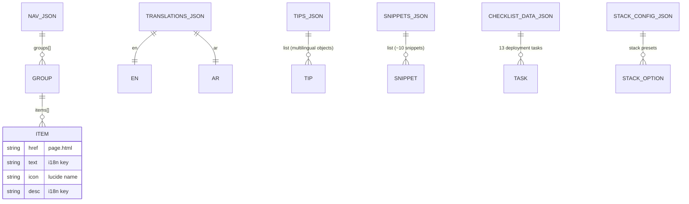

# Architecture Overview

## Module Graph

## Boot Sequence (`App.init()`)

1. `UI.initTheme()` — runs first to prevent light-mode flash.
2. `I18n.updateDirection()` — sets `<html dir>` / `lang` (`ar` → RTL).
3. Translations loaded into `State`; DOM strings applied via `data-i18n*` attributes.
4. `App.isReady = true` and the global **`appReady`** event is dispatched on `window`.

Tools must wait for `App.isReady` or the `appReady` event before touching translated DOM.

## Tool Registration Pattern

`App.registerTool(id, config)` wraps config in a `BaseTool` instance and stores it in `App.tools`. `BaseTool` wires shared file-handling UI by convention (default element IDs, overridable via config):

| Config key | Default ID | Purpose |
|---|---|---|
| `dropZoneId` | `drop-zone` | Drag & drop target |
| `fileInputId` | `file-input` | File picker |
| `progressBarId` | `progress-bar` | Progress bar |
| `progressStatusId` | `progress-status` | Status text |
| `processedCountId` | `processed-count` | Counter |
| `overlayId` | `processing-overlay` | Processing overlay |
| `cancelBtnId` | `cancel-btn` | Cancel button |
| `resultsId` | `results-section` | Results container |
| `multiple` | `false` | Multi-file support |

Drop-zone highlight uses `border-primary bg-primary/5` classes during dragover.

## Data Schema

All content lives in versioned JSON under `src/data/`:

- **translations.json** — flat key→string maps per locale; page meta uses `title_<page>` / `desc_<page>` keys.
- **nav.json** — three groups: `nav_group_media`, `nav_group_workflow`, `nav_group_dev`.
- **tips.json / snippets.json** — each entry carries both `en` and `ar` variants.
- Duplicated copies exist in `public/js/data/` for legacy/static fallback; `src/data/` is the source of truth.

## Build Pipeline

`vite.config.js`:
- Scans root `*.html` files → Rollup multi-page inputs.
- `base: './'` for relative asset URLs (Pages-friendly).
- Tailwind via `@tailwindcss/vite`.
- PWA: autoUpdate service worker, manifest named *WPToolbox*, theme `#09090b`, SVG favicon at 192/512.
